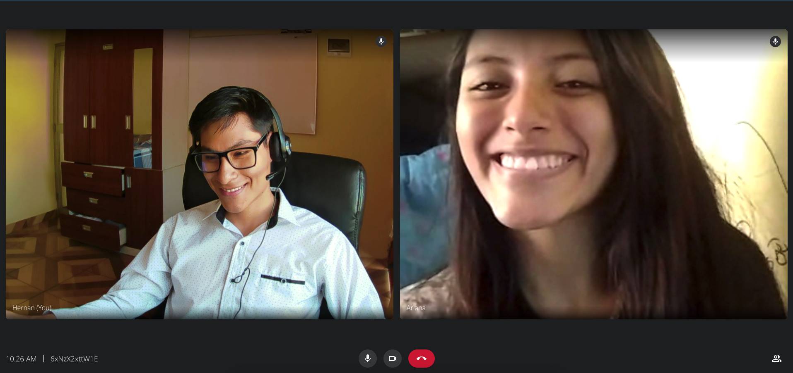
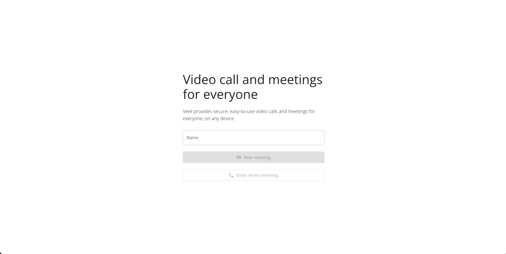
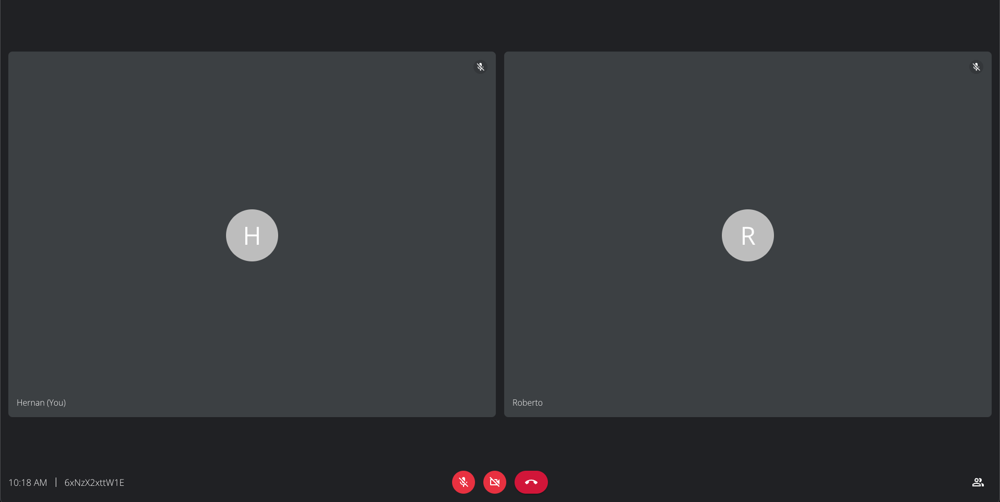
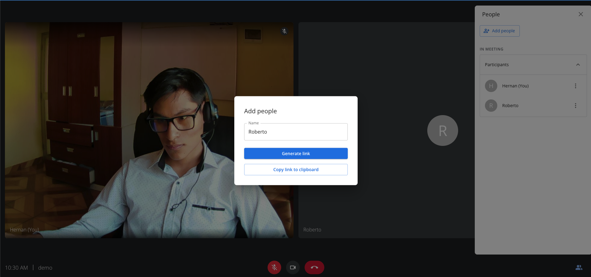

# Veet - Conferencia de video como servicio de código abierto



Veet es un clon full-stack de Google Meet, implementado en frontend con React.js, backend en Node.js y desplegado en AWS.

## Estructura del monorepositorio

```js
+-- apps
|   +-- api // servicio principal de API Rest para la aplicación
|   +-- web // aplicación frontend
+-- docs // activos de documentación
|   +-- screenshoots // capturas de pantalla de la aplicación completa desplegada
+-- infra // Infraestructura como código con AWS CDK en TypeScript para desplegar la aplicación (próximamente)
+-- package.json // package.json principal para el monorepositorio
+--
```

## Capturas de pantalla




